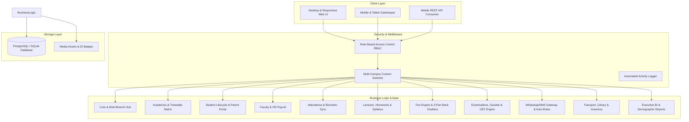

# 🏫 GEN'X VISION SCHOOL SYSTEM — Enterprise ERP Skill Guide

> **Official Developer & System Operations Skill Handbook**  
> **Platform:** GEN'X VISION SCHOOL SYSTEM — Multi-Campus Management ERP  
> **Tech Stack:** Django 5.x / 6.0 | Python 3.12+ | Vanilla CSS Design System | SQLite / PostgreSQL | Chart.js  

---

## 1. System Overview & Core Architecture

GEN'X VISION SCHOOL SYSTEM ERP is a distributed, multi-campus school management platform designed for full institutional lifecycle management across all academic, administrative, financial, and logistical tiers.



---

## 2. Directory & Modular App Topology

The codebase follows a clean Django app architecture structured under the `apps/` namespace:

| App Path | Module Name | Primary Responsibilities & Models |
|---|---|---|
| `apps/core/` | **Core & Multi-Campus** | `Branch`, `SchoolSetting`, `ActivityLog`, `Notification`. Manages school profile, multi-branch context, QR tokens, security scanner, backup downloads. |
| `apps/accounts/` | **Auth & RBAC** | Custom `User` model with 8 distinct institutional roles (`SUPER_ADMIN`, `ADMIN`, `PRINCIPAL`, `COORDINATOR`, `TEACHER`, `ACCOUNTANT`, `STUDENT`, `PARENT`, `STAFF`). Decorators (`@coordinator_required`, `@accountant_required`, `@teacher_required`). |
| `apps/academics/` | **Curriculum & Matrix** | `AcademicYear`, `ClassRoom`, `Section`, `Subject`, `ClassSubject`, `Period`, `TimetableEntry`. Complete class levels (Playgroup to Class 10 Metric), section assignment, weekly conflict-checking timetable grid. |
| `apps/students/` | **Student Directory** | `Student`, `StudentDocument`, `StudentPromotionHistory`. Bio-data, B-Form/CNIC validation, batch & single PVC ID cards, character certificates, annual promotion engine, parent portal. |
| `apps/teachers/` | **Faculty & HR** | `Teacher`, `SalaryPayment`, `StaffLeave`, `TeacherPerformance`. Employee records, basic salary, allowances, monthly payroll disbursement, performance scoring (10-point KPI). |
| `apps/attendance/` | **Attendance & Biometrics** | `StudentAttendance`, `TeacherAttendance`, `BiometricDevice`, `BiometricPunch`, `StudentLeaveRequest`. Daily register, hardware turnstile sync simulation, leave approval updating registers to `EXCUSED`. |
| `apps/lectures/` | **Lectures & Homework** | `DailyLecture`, `Homework`, `HomeworkSubmission`. Daily teacher diaries, homework assignments with file attachments, digital student submissions, rubric evaluation & grading. |
| `apps/syllabus/` | **Syllabus Tracker** | `SyllabusChapter`, `SyllabusTopic`. Subject syllabus breakdown, topic completion status, interactive progress bars. |
| `apps/fees/` | **Financial & Challans** | `FeeCategory`, `FeeStructure`, `FeeInvoice`, `FeeInvoiceItem`, `FeePayment`, `StudentDiscount`. 3-part authentic bank challans (Bank, School, Student copies), bulk monthly billing, manual collection, student ledger, defaulters list. |
| `apps/expenses/` | **Expense & Ledgers** | `ExpenseCategory`, `Expense`. Institutional utility, maintenance, salary, and overhead expense tracking with monthly cashflow summaries. |
| `apps/examinations/` | **Exams & Online CBT** | `Exam`, `ExamSchedule`, `ExamMarksEntry`, `GradingScale`, `OnlineAssessment`, `AssessmentQuestion`, `StudentAssessmentAttempt`. Examination schedules, result calculation, printable official report cards, timed Computer-Based Testing with instant auto-grading. |
| `apps/communication/` | **Notice Board & Gateways** | `Announcement`, `SMSWhatsAppGateway`, `NotificationTemplate`, `AutomatedNotificationRule`, `NotificationQueue`. Circulars, bulk broadcast, automated absence/fee overdue triggers, background queue dispatcher. |
| `apps/transport/` | **Fleet & Routes** | `Vehicle`, `Route`, `RouteStop`, `StudentTransportAllocation`. Bus fleet roster, pick/drop stops, per-student monthly transport fare allocations. |
| `apps/library/` | **Library Catalog** | `BookCategory`, `Book`, `BookIssue`. ISBN tracking, available copy counts, book checkout and overdue return tracking. |
| `apps/inventory/` | **Asset Inventory** | `ItemCategory`, `Supplier`, `InventoryItem`, `StockTransaction`. Lab equipment, stationery, uniform stock ledger (Stock IN / Stock OUT audit trail). |
| `apps/reports/` | **Executive Analytics** | Demographics, attendance, financial recovery, exam pass rate reports, and executive multi-campus profit/loss forecasting dashboard. |
| `apps/api/` | **REST APIs & Docs** | Django REST Framework API endpoints for mobile integration (`/api/v1/students/`, `/api/v1/teachers/`, `/api/v1/attendance/`, `/api/v1/homework/`, `/api/v1/fees/`, `/api/v1/exams/results/`, `/api/v1/announcements/`, `/api/v1/docs/`). |

---

## 3. Academic Hierarchy & Class Structure Reference

All classes are configured in continuous, ordered numeric levels to guarantee consistent progression in dropdowns, timetable slots, and promotion engines:

```mermaid
graph LR
    PG[Playgroup #0] --> NUR[Nursery #1]
    NUR --> PREP[Prep #2]
    PREP --> C1[Class 1 #3]
    C1 --> C2[Class 2 #4]
    C2 --> C3[Class 3 #5]
    C3 --> C4[Class 4 #6]
    C4 --> C5[Class 5 #7]
    C5 --> C6[Class 6 #8]
    C6 --> C7[Class 7 #9]
    C7 --> C8[Class 8 #10]
    C8 --> C9[Class 9 Metric #11]
    C9 --> C10[Class 10 Metric #12]
```



### Class Management Endpoints:
- **Class List & Manage Hub:** `/academics/classes/`
- **Class Edit Action:** POST `action=edit_class` with `class_id`, `name`, `code`, `numeric_level`, `description`.
- **Section Edit Action:** POST `action=edit_section` with `section_id`, `class_room`, `name`, `capacity`, `class_teacher`.
- **Section Delete Action:** POST `/academics/sections/<id>/delete/` (guarded against active enrollments).

---

## 4. Key Subsystem Workflows & Code Patterns

### 4.1 3-Part Authentic Bank Fee Challan
- **Template:** `templates/fees/fee_challan_3part.html`
- **Endpoint:** `/fees/challans/<invoice_id>/3part/` (alias `/fees/invoices/<invoice_id>/challan/`)
- **Layout:** Standard A4 Landscape with 3 identical columns:
  1. `BANK COPY` (Retained by depositing bank)
  2. `SCHOOL COPY` (Submitted to accounts office)
  3. `STUDENT COPY` (Student / parent receipt record)
- **Included Details:** Bank account title/IBAN, barcode, invoice #, student ID, student name, father name, class/section, fee breakdown items, due date, validity date, bank stamps/signatures.

### 4.2 Online Computer-Based Testing (CBT) Engine
- **Models:** `OnlineAssessment` -> `AssessmentQuestion` (MCQ / True-False) -> `StudentAssessmentAttempt`
- **Endpoints:**
  - Assessment Hub: `/examinations/cbt/`
  - Create Assessment: `/examinations/cbt/create/`
  - Manage Questions: `/examinations/cbt/<id>/questions/`
  - Test Taking Engine: `/examinations/cbt/<id>/take/` (alias `/start/`)
  - Cohort Ranking & Results: `/examinations/cbt/<id>/results/`
- **Features:** JS countdown timer, question pagination, auto-submission on timeout, real-time score grading, pass/fail status calculation.

### 4.3 Biometric Turnstile Sync & Leave Approval
- **Endpoints:**
  - Biometric Hub: `/attendance/biometric/`
  - Hardware Sync Action: POST `/attendance/biometric/sync/`
  - Leave Applications: `/attendance/leaves/`
  - Leave Approval: POST `/attendance/leaves/<id>/approve/`
- **Behavior:** When an admin approves a leave request, all date instances in the range are automatically logged in `StudentAttendance` as `Status.EXCUSED`.

### 4.4 Automated WhatsApp & SMS Triggers
- **Endpoints:**
  - Gateway Setup: `/communication/gateways/`
  - Queue Monitor: `/communication/queue/`
  - Trigger Daily Absence: POST `/communication/trigger/absence/`
  - Trigger Fee Overdue: POST `/communication/trigger/fee-overdue/`
  - Process Queue Dispatch: POST `/communication/queue/dispatch/`
- **Rules Engine:** Evaluates daily absence logs or unpaid overdue invoices and enqueues templated SMS/WhatsApp payloads.

---

## 5. UI/UX Design System & Branding Tokens

The application employs a custom high-contrast CSS design system rooted in `static/css/style.css`:

```css
:root {
    --primary: #2563eb;          /* Vibrant Royal Blue */
    --primary-dark: #1d4ed8;     /* Deep Blue Hover */
    --primary-light: #eff6ff;    /* Soft Tint Background */
    --navy-deep: #0f172a;        /* Sidebar Deep Slate */
    --sidebar-active: #1e293b;    /* Active Item Background */
    --accent-coral: #ef4444;     /* Crimson Red Accent */
    --success: #10b981;          /* Emerald Green */
    --warning: #f59e0b;          /* Amber */
    --danger: #ef4444;           /* Danger Coral */
    --bg-main: #f8fafc;          /* Application Canvas */
    --card-bg: #ffffff;          /* White Card Container */
    --text-main: #0f172a;        /* High Contrast Charcoal */
    --text-muted: #64748b;       /* Secondary Text */
}
```

### Brand Typography Standards:
- **School Logo / Name in Sidebar:**
  - `GEN'X VISION`: Pure White (`#ffffff`), `font-weight: 800`, `letter-spacing: 0.5px`.
  - `SCHOOL SYSTEM`: Vibrant Red (`#ef4444`), `font-weight: 700`, `letter-spacing: 1px`.
- **Card Styling:** Clean border (`1px solid #e2e8f0`), rounded corners (`12px`), elevation shadow.

---

## 6. Development, Seeding & QA Testing Protocols

### 6.1 Essential Terminal Commands
```powershell
# Start Django Local Development Server
python manage.py runserver 127.0.0.1:8000

# Apply Database Schema Migrations
python manage.py makemigrations
python manage.py migrate

# Seed Complete Initial Data (Classes, Students, Teachers, Invoices, Exams)
python manage.py seed_sprint1
python manage.py seed_full_system
```

### 6.2 Automated Quality Assurance Suites
Two master test scripts are available to perform exhaustive verification:

1. **Master Enterprise Audit (Core Sprints):**
   ```powershell
   python qa_master_enterprise_audit.py
   ```
   *Runs 48 cross-module security, multi-campus, biometric, fee, and exam tests.*

2. **Comprehensive System-Wide Health Check (All 90 Routes):**
   ```powershell
   python comprehensive_system_check.py
   ```
   *Crawls and validates all 90 view routes, forms, challans, CBT tests, and REST API endpoints (Target: 100% Pass Rate).*

---

## 7. Role-Based Access Control & User Roles

| Role Constant | Display Label | Accessible Modules |
|---|---|---|
| `SUPER_ADMIN` / `ADMIN` | Administrator | Full unrestricted access to all 16 apps, settings, user management, backups, and campuses. |
| `PRINCIPAL` | Principal / Director | Executive analytics, academic gazettes, faculty evaluations, fee summaries, circular broadcasts. |
| `COORDINATOR` | Academic Coordinator | Classes, subjects, timetables, syllabus tracker, homework evaluations, teacher performance. |
| `TEACHER` | Faculty Member | Assigned class attendance, lecture diary, homework assignment & grading, exam marks entry. |
| `ACCOUNTANT` | Accounts Officer | Invoices, fee collection, 3-part bank challans, student ledgers, defaulters, expense registers. |
| `STUDENT` / `PARENT` | Student / Guardian | Parent portal, student report card, timetable, digital homework submissions, online CBT tests. |
| `STAFF` | Security / Gatekeeper | QR badge scanner verification gateway, transport vehicle logs, asset inventory. |

---

## 8. Common Gotchas & Developer Best Practices

1. **Windows PowerShell Output Encoding:**
   Always include `sys.stdout.reconfigure(encoding='utf-8', errors='replace')` in standalone python scripts when running on Windows to prevent Unicode/emoji crashes.
2. **Fee Invoice Field Names:**
   Always use `subtotal_amount`, `payable_amount`, `paid_amount`, and `balance_amount`. Do not query `total_amount`.
3. **Teacher Subject Assignment Relations:**
   `ClassSubject.teacher` is a Foreign Key to `apps.accounts.User` with `related_name='teaching_subjects'`. Use `teacher_obj.user.teaching_subjects.all()` to access assigned subjects.
4. **Syllabus Models:**
   Located in `apps.syllabus.models` as `SyllabusChapter` and `SyllabusTopic`.
5. **Multi-Campus Filtering:**
   When adding campus-scoped models, always include `branch = models.ForeignKey(Branch, on_delete=models.CASCADE, null=True, blank=True)` to enable automatic tenant filtering.
