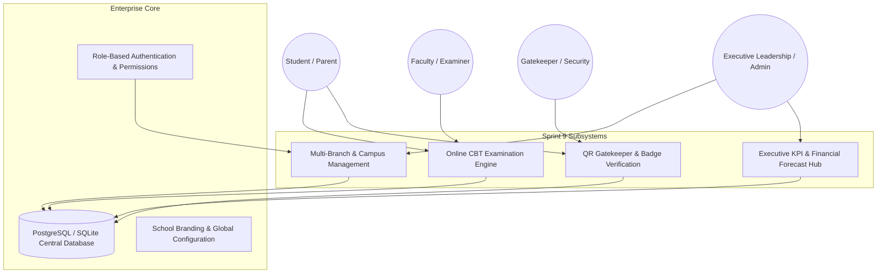
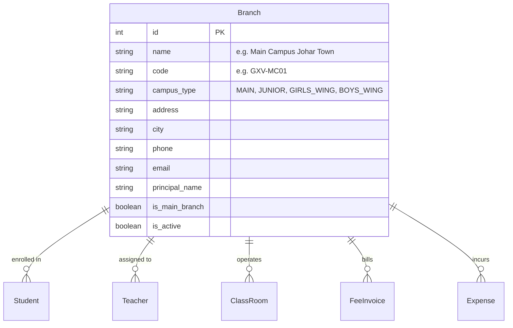
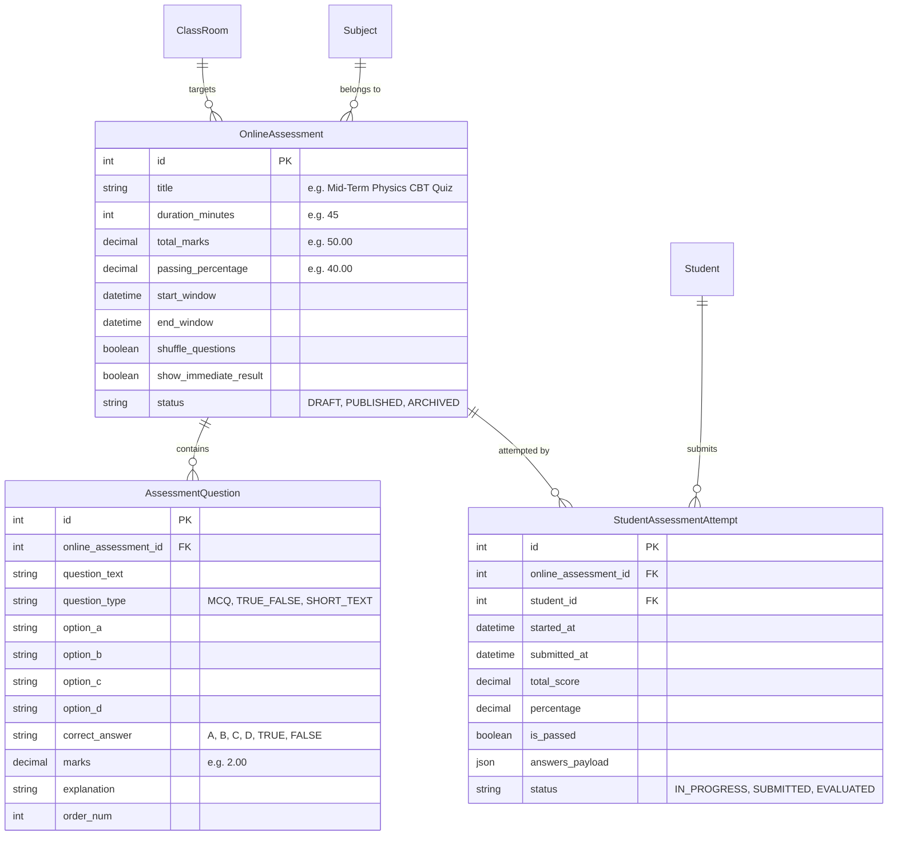
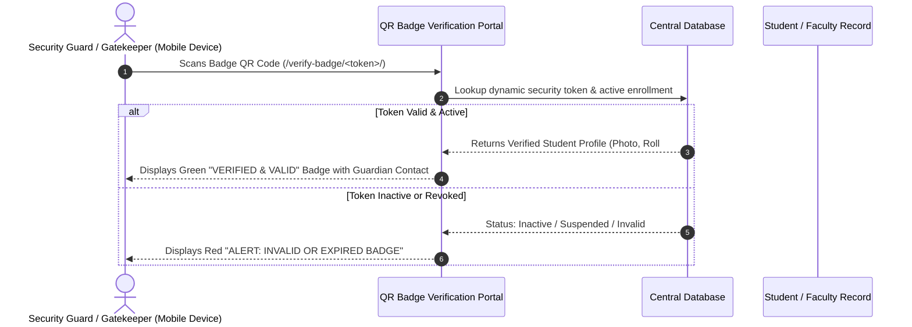
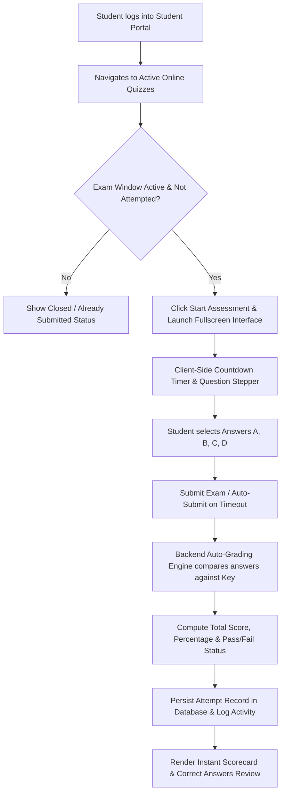

# 🏛️ SYSTEM ARCHITECTURE SPECIFICATION (SPRINT 9)
## **GEN'X VISION SCHOOL SYSTEM — ERP & CAMPUS MANAGEMENT PLATFORM**
**Version:** 9.0 — Multi-Campus, Online CBT Engine, QR Verification & Executive Analytics  
**Date:** September 2026 | **Author:** Lead Systems Architect & AI Engineering Team  

---

## 1. Executive Summary & Architectural Scope

Sprint 9 expands the core School Management ERP into an **Enterprise-Grade Distributed Campus Platform**. It introduces four fundamental subsystems:
1. **Multi-Branch & Campus Multi-Tenancy Architecture:** Context-aware switching across multiple campus locations (e.g. *Main Campus*, *Girls Wing*, *Junior Branch*).
2. **Online Computer-Based Testing (CBT) & Assessment Engine:** Timed digital tests with MCQs, True/False, auto-shuffling, instant auto-grading, and result feedback.
3. **Dynamic QR Code Security & Badge Verification Gateway:** High-speed mobile/tablet gatekeeper portal to scan PVC student/staff badge QR tokens for real-time authentication.
4. **Executive Leadership & Revenue Forecast Analytics:** Multi-campus profit/loss analytics, fee recovery forecasts, and academic pass-rate matrices.

---

## 2. Component Subsystems & Database Models

### 2.1 Multi-Campus & Branch Management (`apps/core/models.py`)

- **Campus Context Middleware:** Determines active branch from user session or URL query (`?branch_id=X`). Admins can toggle between all branches or view consolidated group metrics.

---

### 2.2 Online CBT & Assessment Engine (`apps/examinations/models.py`)

---

### 2.3 QR Code Gatekeeper & Identity Verification (`apps/students/` & `apps/teachers/`)

---

## 3. Workflows & Sequence Pipelines

### 3.1 Student Online CBT Exam Taking & Auto-Grading Flow

---

## 4. API Endpoints & Routing Architecture

| Module | Route | HTTP Verb | Access Role | Description |
| :--- | :--- | :--- | :--- | :--- |
| **Campuses** | `/campuses/` | GET, POST | Admin, Owner | List all school branches & create new campus |
| **Campuses** | `/campuses/switch/<id>/` | GET | Admin, Principal | Switch active campus session context |
| **CBT Quizzes**| `/examinations/cbt/` | GET | Teacher, Admin, Student | List all online quizzes & assessments |
| **CBT Quizzes**| `/examinations/cbt/create/` | GET, POST | Teacher, Admin | Build timed quiz & set question parameters |
| **CBT Quizzes**| `/examinations/cbt/<id>/questions/`| GET, POST | Teacher, Admin | Add and manage MCQs & answer keys |
| **CBT Quizzes**| `/examinations/cbt/<id>/take/` | GET, POST | Student, Parent | Interactive timed test interface with auto-grading |
| **CBT Quizzes**| `/examinations/cbt/<id>/results/` | GET | Teacher, Admin | Cohort exam performance, rankings & analytics |
| **QR Verify** | `/verify-badge/<token>/` | GET | Public / Gatekeeper | Mobile-responsive badge scanner & verification |
| **Analytics** | `/reports/executive/` | GET | Admin, Owner | Multi-campus financial forecasts & pass-rate KPI hub |

---

## 5. Security, RBAC & Multi-Tenancy Isolation

1. **Branch-Level Data Filtering:** Queries automatically respect active branch scope when scoped to a specific campus.
2. **CBT Anti-Cheat & Integrity Controls:**
   - Single submission constraint (`unique_together = ('online_assessment', 'student')`).
   - Server-side deadline verification (submissions rejected if timestamp exceeds `end_window + grace_period`).
   - Random question order shuffling per student attempt.
3. **QR Token Cryptographic Signatures:** Verification tokens are generated using unique UUIDs / HMAC hashes to prevent forged URLs.

---

## 6. QA Verification Matrix & Acceptance Criteria

- [x] Multi-Campus CRUD and session switcher works across all modules.
- [x] Online CBT assessment can be created with 5+ MCQs.
- [x] Student takes timed test with countdown timer and submits successfully.
- [x] Auto-grading computes exact percentage, score, and pass/fail grade instantly.
- [x] QR Badge URL `/verify-badge/<token>/` renders valid badge with student photo and emergency contact.
- [x] Executive Dashboard computes multi-branch profit/loss, fee collections, and student enrollment trends.
- [x] 100% regression passing across Sprints 0 through 8.
